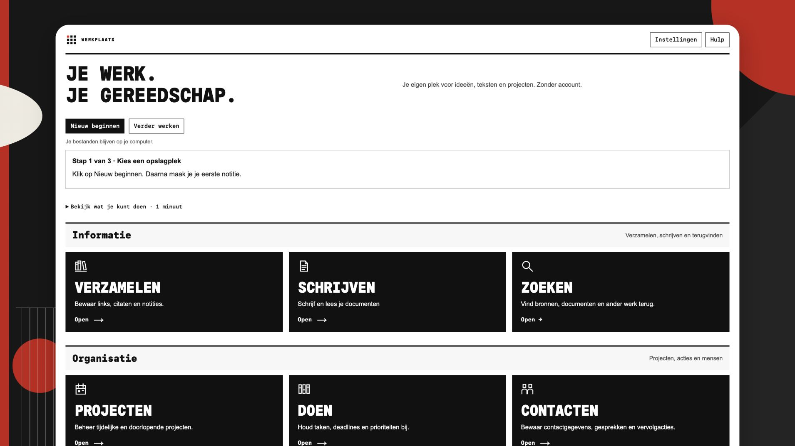

# Werkplaats

Je eigen werkplek voor ideeën, teksten en projecten. Gratis. Zonder account. Je bestanden blijven op je computer.

## Waarom ik dit deel

Ik ben geen programmeur en geen designer. Met AI maak ik tools en skills die ik zelf nodig heb. Ik deel ze om te laten zien wat er nu mogelijk is, je enthousiast te maken en je op gang te helpen. Gebruik dit als vertrekpunt: bouw erop voort en maak het passend bij jouw werk, smaak en wensen.

Voor dagelijks gebruik hoeft AI niet mee te draaien: Werkplaats werkt in je browser, zonder AI-account of AI-abonnement. Credits voor Joost Plattel, Erik van Elten en andere makers blijven gewoon staan.

**[Open Werkplaats](https://erwinblom.github.io/werkplaats/)**

**Voor bewaren in een map heb je Chrome of Edge op je computer nodig.** Safari, Firefox en ingebouwde browsers kunnen hier geen werkmap kiezen. Je hoeft geen broncode aan te passen.

[Bekijk de uitlegvideo](https://erwinblom.github.io/werkplaats/Video/Werkplaats-uitlegvideo.mp4) · [Download voor offline gebruik](https://github.com/erwinblom/werkplaats/releases/latest/download/Werkplaats.zip)

<a href="https://erwinblom.github.io/werkplaats/"></a>

## Beginnen

1. Kies **Nieuw beginnen** en bevestig een opslagplek, bijvoorbeeld het bureaublad. Werkplaats maakt zelf **Mijn Werkplaats** met de submappen aan. Elke tool vraagt eerst om een nieuwe of bestaande werkmap.
2. Schrijf je idee in de eerste notitie die wordt geopend.
3. Klik **Bewaar**. Open later dezelfde werkmap via **Verder werken**.

## Nieuw in 0.36.18: Databases voor beginners en gevorderden

Maak je eigen overzichten, van boekenlijst tot voorraad. Open **Databases** op Home en kies hoe je wilt beginnen:

- **Boeken**: titel, schrijver en leesstatus.
- **Uitleenlijst**: wat je uitleent, aan wie en wanneer het terugkomt.
- **Voorraad**: artikel, aantal, eenheid en plek.

De kolommen staan klaar; er worden geen verzonnen gegevens opgeslagen. Een korte begeleiding helpt je **je eerste eigen rij toevoegen, bewaren, opnieuw openen en terugvinden**. Zoeken kijkt in alle rijen van je tabel.

Werk je liever met je eigen indeling? Kies **Zelf beginnen**. Met **Bestaande database openen** voeg je een eigen kopie van een SQLite-bestand toe. Eigen tabellen, rijen bewerken, CSV-import en een SQLite-download blijven beschikbaar onder **Meer**.

Je hebt geen account of databaseserver nodig. De SQLite-engine wordt meegeleverd en werkt offline. Je bestanden blijven in je eigen werkmap. Maximaal 20 MB per database en 5.000 rijen per CSV-import. Gebruik na een update dezelfde werkmap om verder te werken.

[Handleiding en aanpassen met AI](app/Databases.md) · [Wat is nieuw in 0.36.18?](release/UITGAVE-0.36.18.md)

<details>
<summary>Offline gebruiken, bijwerken en overstappen</summary>

Download de ZIP, pak hem volledig uit en open **Werkplaats → Begin hier.html**. Alle overige bestanden staan in **Bestanden**; laat die map intact.

Website en download worden uit dezelfde gecontroleerde Master gemaakt. Een gedownloade versie werkt zichzelf niet bij: download voor verbeteringen de nieuwe uitgave. Je werk wordt niet automatisch gesynchroniseerd tussen versies of browsers.

Je begint met je eigen werk. Er is geen voorbeeldstand met fictieve projecten, contacten of financiële gegevens.

Gebruik Chrome of Edge op je computer voor maptoegang. Zonder maptoegang kun je losse bestanden importeren en exporteren. Controleer zelf of een download is opgeslagen. Browseropslag is een tijdelijke werkkopie; je werkmap en back-ups zijn de blijvende kopieën.

Bestaande gebruikers: bewaar eerst je actuele werk in de oude versie. Open na de update dezelfde werkmap via Verder werken; vertrouw niet op een nog aanwezige browserkopie.

</details>

<details>
<summary>Wat zit erin?</summary>

| Onderdeel | Gebruik |
|---|---|
| Verzamelen | Links en citaten bewaren; kiezen tussen Lezen, Luisteren, Kijken, Proberen en Inspireren |
| Schrijven | Notities en documenten; gekoppelde bronnen, afbeeldingen en ander materiaal |
| Zoeken | Je eigen werk doorzoeken |
| Databases | Eigen SQLite-bestanden, tabellen en rijen; CSV importeren en downloaden |
| Projecten | Tijdelijke en doorlopende projecten met gekoppeld materiaal |
| Doen | Taken, deadlines en prioriteiten |
| Contacten | Contactgegevens, gesprekken en vervolgacties |
| Facturen | Facturen, offertes en uren; zelf controleren en delen |
| Abonnementen | Kosten, verlengdatums en opzegdatums bijhouden |
| Boekhouding | Inkomsten, uitgaven, bonnen en export |

</details>

In Verzamelen kies je categorieën uit één menu. Open een bron en blader met Vorige/Volgende of de toetsenbordpijlen door je huidige selectie. De ster bewaart je persoonlijke shortlist.

## Maak Werkplaats van jezelf

Via **Instellingen → Mijn Werkplaats** kies je je naam, kleur, bureaublad en welke gereedschappen je ziet.

[Bekijk hoe je Werkplaats personaliseert](https://erwinblom.github.io/werkplaats/Video/Werkplaats-personaliseren.mp4)

<details>
<summary>Meer aanpassen, zonder code of met hulp van AI</summary>

Je kiest ook de volgorde van de onderdelen en je starttool. Je kunt zes meegeleverde bureaubladen gebruiken of een eigen afbeelding kiezen. Voeg daarnaast compacte snelkoppelingen en eigen projectstatussen, contactlabels en categorieën toe. Verborgen onderdelen behouden hun gegevens. De interface ondersteunt Nederlands en Engels; je eigen inhoud blijft in zijn oorspronkelijke taal.

Werkplaats is een open-source vertrekpunt, geen vast pakket dat iedereen hetzelfde moet gebruiken. Veel pas je zonder code aan. Wil je verder gaan, dan kun je de gewone HTML-, CSS- en JavaScriptbestanden zelf of met hulp van AI aanpassen. Zo kun je functies en complete gereedschappen toevoegen, veranderen of verwijderen. AI is daarbij een hulpmiddel tijdens het bouwen. Zodra je de aangepaste code hebt opgeslagen, werkt je versie zelfstandig: AI hoeft niet bij ieder gebruik opnieuw iets te bedenken of uit te voeren. De code voert de vastgelegde instructies uit. Controle en onderhoud blijven nodig. Werk vanuit een kopie en controleer na iedere wijziging of openen, bewaren en heropenen nog goed werken. Dat is de praktische kracht van open source: je begint met iets bruikbaars en maakt het daarna echt van jezelf.

</details>

[Uitleg en gebruik](https://erwinblom.github.io/werkplaats/Uitleg.html) · [Over Werkplaats](https://erwinblom.github.io/werkplaats/Over.html) · [Privacy](app/PRIVACY.md)

<details>
<summary>Meer over bewaren, herstel en overstappen</summary>

**Bewaar** schrijft je notitie naar je werkmap. **Sluit** sluit de editor; wijzigingen kunnen dan nog alleen in de browser staan. **Bewaar alles** schrijft de hele werkruimte naar je werkmap, inclusief concepten, met een actuele bewaarronde en een vorige herstelkopie. Bij **Verder werken** haal je die werkruimte terug. Een document in een externe map blijft bij zijn oorspronkelijke bestand.

**Download back-up** maakt een ZIP van de laatst bewaarde werkmap. Gebruik eerst Bewaar alles. Losse JSON-, Markdown-, CSV- en PDF-exports staan bij de betreffende tool. Verwijderacties gebruiken waar beschikbaar de Prullenbak om terugzetten mogelijk te houden.

Wil je tussen website en download wisselen? Bewaar eerst, sluit de vorige versie en open dezelfde werkmap. Gebruik één actuele administratie; werk niet onafhankelijk in meerdere kopieën.

</details>

## Aan de slag

Zie je iets dat slimmer kan? Pak je gereedschap — of je favoriete AI — en probeer het in een kopie. Een bug melden of een idee delen mag natuurlijk ook. Je hoeft niet op mijn planning te wachten om iets naar jouw hand te zetten.

- **[Meld een fout](https://github.com/erwinblom/werkplaats/issues/new?template=bug.md)**: wat deed je, wat verwachtte je en wat gebeurde er?
- **[Stel een verbetering voor](https://github.com/erwinblom/werkplaats/issues/new?template=verbetering.md)**: wat wil je kunnen doen en welk probleem lost dat op?
- **[Deel een uitbreiding](https://github.com/erwinblom/werkplaats/issues/new?template=uitbreiding.md)**: wat heb je gebouwd, voor wie en waar staat de code of ZIP?

Je kunt ook **[mailen naar erwblo@gmail.com](mailto:erwblo@gmail.com?subject=Werkplaats%20verbeteren)**. Een GitHub-account is daarvoor niet nodig. In Werkplaats vind je dezelfde drie keuzes onder **Help Werkplaats verbeteren** op de startpagina en onder **Hulp**. Bekijk de tekst vóór je deelt; lokaal bewaren verzendt niets. Je verstuurt de e-mail of plaatst de GitHub-melding zelf.

Erik van Elten maakte bijvoorbeeld Agenda-export. Na controle kreeg die een plek in Werkplaats, met zijn naam erbij. Ook jouw bijdrage is welkom. Uitbreidingen worden vóór opname gecontroleerd en de maker blijft vermeld.

[Hoe je kunt bijdragen](CONTRIBUTING.md)

**[Maak je eigen uitbreiding](UITBREIDINGEN-MAKEN.md)** — afspraken voor makers, een compleet eerste voorbeeld en de route naar de meegeleverde catalogus. Ook zonder programmeerkennis kun je met hulp van AI beginnen.

## Agenda-export van Erik van Elten

Met Agenda-export zet je deadlines en datums uit Doen, Projecten, Contacten en Abonnementen in je eigen agenda. Kies welke onderdelen je wilt meenemen en download een .ics-bestand. Open of importeer dat in je agenda. Afgeronde items en herinneringen zijn optioneel.

**Gemaakt door Erik van Elten.** Hij bouwde de oorspronkelijke Agenda-export 0.1.0. De exportkern is behouden. De aansluiting op de vaste uitbreidingenplek van Werkplaats is aangepast door Erwin Blom met hulp van Codex. De oorspronkelijke MIT-licentie en copyrightvermelding van Erik blijven opgenomen.

### Toevoegen

1. Open Werkplaats in Chrome of Edge op je computer en kies je werkmap.
2. Ga naar **Instellingen → Uitbreidingen**. Klik **Toevoegen** bij Agenda-export van Erik van Elten.
3. Kies welke onderdelen je wilt meenemen en klik **Download agenda (.ics)**. Open of importeer het bestand in je agenda.

Werkplaats plaatst de meegeleverde uitbreiding zelf in je werkmap en zet haar aan. Je hoeft niets apart te downloaden, uit te pakken of te kopiëren. Een bestaande aangepaste installatie wordt niet overschreven. Eigen uitbreidingen kun je handmatig toevoegen via **Zelf een uitbreiding toevoegen**.

Bij een Werkplaats-update blijven de uitbreiding en keuzes bij je werk staan. Open dezelfde werkmap; de browser kan opnieuw maptoegang vragen. Je hoeft de uitbreiding niet opnieuw te installeren.

Het agendabestand is een momentopname, geen automatische synchronisatie. Bij herhaald importeren kunnen afspraken dubbel verschijnen; dat verschilt per agenda. Bewaar een aparte back-up van de map Uitbreidingen, want Bewaar alles neemt die map niet mee.

[Uitleg in Werkplaats](https://erwinblom.github.io/werkplaats/Uitleg.html#agenda-export) · [Broncode en MIT-licentie](app/Uitbreidingen/agenda-export/)

<details>
<summary>Links bewaren met de browserextensie</summary>

[Link Bewaren — lokaal](https://erwinblom.github.io/werkplaats/Link-bewaren.html) is een optionele Chrome-/Edge-extensie voor Verzamelen. Links blijven lokaal; via **Importeer links** haal je ze naar Werkplaats. Voor lokaal gebruik zet je in de browser **Toegang tot bestands-URL's toestaan** aan. De actuele extensie ondersteunt de website en de downloadindeling met Bestanden.

De losse extensie staat in [extensies/link-bewaren-lokaal](extensies/link-bewaren-lokaal/LEESMIJ.md). Er is geen Google Sheet of aparte opslagserver nodig.

**Inbox verwerken** verschijnt alleen wanneer er bronnen in Inbox staan. Daarmee bekijk je ze één voor één en kies je zelf een categorie en eventuele subcategorie. Na het verwerken van de laatste bron verdwijnt de knop. Gebruik daarna **Bewaar alles**.

</details>

<details>
<summary>Voor beheerders: bron, bouwen en uitgeven</summary>

De dagelijkse ontwikkelapp blijft de enige ontwikkelbron. De vaste Master-builder sluit persoonlijke werkgegevens, privé-sync, persoonlijke feedback, herstelinstellingen en de persoonlijke boekhoudexport uit. Alleen die gecontroleerde Master wordt hier geïmporteerd. Ontwikkel de publiekskopie niet los van de oorspronkelijke App.

- `app/`: gecontroleerde publieksbron uit de Master.
- `release/master-bestanden.json`: controlecodes en uitsluitingen van die import.
- `docs/`: gegenereerde GitHub Pages-website.
- `dist/Werkplaats.zip`: gegenereerde download, buiten Git opgeslagen.

Na het maken van de schone Master:

```sh
python3 scripts/import-master.py /pad/naar/Master
python3 scripts/build.py
python3 scripts/check.py
```

Importeren controleert eerst de Master tegen het manifest. Bouwen maakt website en ZIP uit dezelfde bestanden, zonder een tweede versie van de appcode te onderhouden. GitHub Pages gebruikt `main` → `/docs`. Publiceer de ZIP en SHA256SUMS.txt bij dezelfde uitgave als de website; alleen een Git-push werkt de release-download niet bij.

De browserproef voor deze uitgave staat in [tests/publieke-uitgave.cjs](tests/publieke-uitgave.cjs). Gebruik een bestaande Playwright-installatie via NODE_PATH. Zie [de controles en grenzen](release/CONTROLE.md). Oudere tests in tests/ stammen deels uit de vorige interface en zijn geen actuele acceptatieclaim.

</details>

## Herkomst en licenties

Schrijven bouwt voort op Markdown Browser van Joost Plattel. Zie [herkomst](app/Apps/Werkbank/HERKOMST.md) en [licenties van gebruikte onderdelen](app/Apps/Werkbank/THIRD_PARTY_NOTICES.md).

Agenda-export is oorspronkelijk gemaakt door **Erik van Elten**. Zijn [MIT-licentie](app/Uitbreidingen/agenda-export/LICENSE) en exportkern blijven behouden. De aansluiting op Werkplaats is aangepast door Erwin Blom met hulp van Codex.

De projectbijdragen zijn beschikbaar onder de [MIT-licentie](LICENSE); oorspronkelijke onderdelen behouden hun eigen licenties en credits. Organisaties kunnen Werkplaats ook op een eigen website of intranet aanbieden.

Bedacht en uitgeprobeerd door [Erwin Blom](https://github.com/erwinblom), gebouwd met AI en werk van andere makers.


## Brief maken en als PDF bewaren

Vul bij Instellingen → Mijn gegevens de organisatienaam, het adres en e-mailadres in. Kies desgewenst een logo (PNG, JPEG of WebP, maximaal 2 MB) en klik Bewaar gegevens. Deze briefgegevens zijn ook beschikbaar wanneer Administratie uit staat.

Kies in Schrijven → Documenten → Nieuw → Nieuwe brief. Het briefhoofd en logo worden in het Markdown-bestand bewaard; latere organisatieaanpassingen veranderen bestaande brieven niet. Bewerk de brief en kies Bewaar. Met Pagina-einde in de opmaakbalk begint de volgende inhoud op een nieuwe afdrukpagina.

Kies Meer → Paginaopmaak / PDF, stel A4-marges en paginanummers in en kies Afdrukken / PDF bewaren. Kies Bewaar als PDF in Chrome of Edge en zet de browseroptie Kop- en voetteksten uit. De definitieve pagina-indeling is zichtbaar in dat afdrukvenster. PDF werkt ook via het bestaande Exporteren-menu. Afbeeldingen moeten volledig geladen zijn voordat afdrukken beschikbaar wordt.

## Windows, Linux en bewaren

De lokale browserroute is met Chrome 156 getest op Ubuntu 24.04 en Windows Server 2022: echte maptoegang, notitie bewaren, volledige browserherstart en een PDF van twee A4-pagina’s. Open na uitpakken Begin hier.html in Chrome; laat Bestanden staan. Het .command-bestand is alleen voor de optionele Mac-startapp.

Versie 0.36.13 herstelt de bewaarmelding na herladen. Werkplaats vergelijkt de actuele inhoud en notities opnieuw met de schijfkopie voordat zij bewaard meldt. Na een browserherstart kan Chrome opnieuw toestemming vragen; een ontbrekende bevestiging wordt niet als bewezen schijfopslag getoond. De geautomatiseerde PDFproef gebruikt de echte app-afdrukroute met Save as PDF; handmatige printerkeuze, fysieke Windows 11-pc’s en andere Linuxdistributies zijn niet integraal getest.

## Nieuw in 0.36.14

- **Zoeken:** filter op Verzamelen, Schrijven of Projecten, met aantallen en tekstcontext. Schrijfvarianten, beperkte typefouten en een kleine expliciete begrippenlijst werken zonder AI.
- **Projectbronnen:** kies in een project Meer → Bookmark koppelen, zoek en selecteer meerdere bronnen. Vanuit Verzamelen kan dit via Koppelingen → Project. Ontkoppelen bewaart de bron; klik daarna Bewaar alles.
- **Afbeeldingenexport:** kies bij een document Meer → Download afbeeldingen, of klik op een beeld. Download ingesloten originelen los of als ZIP. De oorspronkelijke bytes blijven behouden; webverwijzingen worden niet opgehaald.

Deze drie uitbreidingen zijn met fictieve gegevens in Chrome op macOS gecontroleerd. Daarnaast slaagden op Chrome 156 in Windows Server 2022 en Ubuntu 24.04 alle 21 platformcontroles: zoeken, projectkoppelingen, echte schijfopslag, herladen, een volledige browserherstart en afbeeldingenexport vanuit een bestaand werkmapdocument. Zie [platformproef 0.36.14](release/PLATFORM-0.36.14.md) voor bewijs en grenzen.


## Nieuw in 0.36.15

Losse Markdown- en tekstbestanden openen wacht nu op het herstel van de werksessie. De succesmelding verschijnt pas als het gekozen document met de juiste inhoud geopend is. Dit voorkomt een aangetoonde botsing tijdens het opstarten. Zie [uitgave 0.36.15](release/UITGAVE-0.36.15.md) voor controles en grenzen.

## Drie uitbreidingen om mee te beginnen — 0.36.16

Open **Instellingen → Uitbreidingen** en kies **Toevoegen** bij wat je wilt gebruiken. De pakketten worden meegeleverd: niets apart downloaden, uitpakken of kopiëren. Ze werken lokaal, zonder AI-account, Python of extra dienst.

| Uitbreiding | Wat je ermee kunt |
|---|---|
| Agenda-export van Erik van Elten | Deadlines en datums uit Werkplaats als bestand naar je agenda brengen. |
| Mijn weekoverzicht | Achterstallige taken, deadlines deze en volgende week, projecten met open taken en wat nu klaar is bekijken, kopiëren of downloaden. |
| Dubbele links vinden | Dezelfde links vergelijken met hun notities en projectkoppelingen. Open de bron in Verzamelen om zelf te kiezen wat je behoudt. |

Gebruik ze vanaf Home. Weekoverzicht werkt ook in Doen en Projecten; Dubbele links vinden ook in Verzamelen en Projecten. Rapporten veranderen of verwijderen geen gegevens. Nu klaar is de huidige kolom Klaar, geen historie van afrondingen deze week. Duplicatenvergelijking behoudt pad, queryparameters en fragmenten.

Bestaande aangepaste installaties worden niet overschreven. Uitbreidingen blijven bij je werkmap na een appupdate. Maak een aparte reservekopie: Bewaar alles neemt de map Uitbreidingen niet mee. De agenda-export is een momentopname, geen synchronisatie.

Gecontroleerd: 51 bronproeven, onafhankelijke codecontrole, 15 volledige Chrome-browserproeven met fictieve gegevens en een echte tijdelijke werkmap op macOS. Inclusief toevoegen, rapporten, kopiëren/downloaden, bronknoppen, uit/aan en herladen. De nieuwe set is niet opnieuw op Windows/Linux getest. Zie [controle 0.36.16](release/UITGAVE-0.36.16.md).
