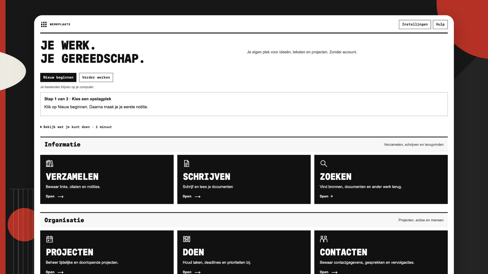

# Werkplaats

Je eigen werkplek voor ideeën, teksten en projecten. Gratis. Zonder account. Je bestanden blijven op je computer.

**Gebouwd met AI. Te gebruiken zonder AI.** AI heeft geholpen om de code van Werkplaats te maken. Daarna draait die code gewoon in je browser: voor het dagelijkse gebruik heb je geen AI, AI-account of AI-abonnement nodig. Ook de offline download werkt zonder AI.

**[Open Werkplaats](https://erwinblom.github.io/werkplaats/)**

**Voor bewaren in een map heb je Chrome of Edge op je computer nodig.** Safari, Firefox en ingebouwde browsers kunnen hier geen werkmap kiezen. Je hoeft geen broncode aan te passen.

[Bekijk de uitlegvideo](https://erwinblom.github.io/werkplaats/Video/Werkplaats-uitlegvideo.mp4) · [Download voor offline gebruik](https://github.com/erwinblom/werkplaats/releases/latest/download/Werkplaats.zip)

<a href="https://erwinblom.github.io/werkplaats/"></a>

## Beginnen

1. Kies **Nieuw beginnen** en kies een opslagplek voor je werkmap.
2. Schrijf je idee in de eerste notitie die wordt geopend.
3. Klik **Bewaar in mijn werkmap**. Open later dezelfde werkmap via **Verder werken**.

<details>
<summary>Offline gebruiken, bijwerken en overstappen</summary>

Download de ZIP, pak hem volledig uit en open **Werkplaats → Begin hier.html**. Alle overige bestanden staan in **Bestanden**; laat die map intact.

Website en download worden uit dezelfde gecontroleerde Master gemaakt. Een gedownloade versie werkt zichzelf niet bij: download voor verbeteringen de nieuwe uitgave. Je werk wordt niet automatisch gesynchroniseerd tussen versies of browsers.

Je begint met je eigen werk. Er is geen voorbeeldstand met fictieve projecten, contacten of financiële gegevens.

Gebruik Chrome of Edge op je computer voor maptoegang. Zonder maptoegang kun je losse bestanden importeren en exporteren. Controleer zelf of een download is opgeslagen. Browseropslag is een tijdelijke werkkopie; je werkmap en back-ups zijn de blijvende kopieën.

Bestaande gebruikers: bewaar eerst je actuele werk in de oude versie. Open na de update dezelfde werkmap via Verder werken; vertrouw niet op een nog aanwezige browserkopie.

</details>

<details>
<summary>Wat zit erin?</summary>

| Onderdeel | Gebruik |
|---|---|
| Verzamelen | Links en citaten bewaren; kiezen tussen Lezen, Luisteren, Kijken, Proberen en Inspireren |
| Schrijven | Notities en documenten; gekoppelde bronnen, afbeeldingen en ander materiaal |
| Zoeken | Je eigen werk doorzoeken |
| Projecten | Tijdelijke en doorlopende projecten met gekoppeld materiaal |
| Doen | Taken, deadlines en prioriteiten |
| Contacten | Contactgegevens, gesprekken en vervolgacties |
| Factureren | Facturen, offertes en uren; zelf controleren en delen |
| Abonnementen | Kosten, verlengdatums en opzegdatums bijhouden |
| Boekhouden | Inkomsten, uitgaven, bonnen en export |

</details>

In Verzamelen kies je categorieën uit één menu. Open een bron en blader met Vorige/Volgende of de toetsenbordpijlen door je huidige selectie. De ster bewaart je persoonlijke shortlist.

## Maak Werkplaats van jezelf

Via **Instellingen → Mijn Werkplaats** kies je je naam, kleur, bureaublad en welke gereedschappen je ziet.

[Bekijk hoe je Werkplaats personaliseert](https://erwinblom.github.io/werkplaats/Video/Werkplaats-personaliseren.mp4)

<details>
<summary>Meer aanpassen, zonder code of met hulp van AI</summary>

Je kiest ook de volgorde van de onderdelen en je starttool. Je kunt zes meegeleverde bureaubladen gebruiken of een eigen afbeelding kiezen. Voeg daarnaast compacte snelkoppelingen en eigen projectstatussen, contactlabels en categorieën toe. Verborgen onderdelen behouden hun gegevens. De interface ondersteunt Nederlands en Engels; je eigen inhoud blijft in zijn oorspronkelijke taal.

Werkplaats is een open-source vertrekpunt, geen vast pakket dat iedereen hetzelfde moet gebruiken. Veel pas je zonder code aan. Wil je verder gaan, dan kun je de gewone HTML-, CSS- en JavaScriptbestanden zelf of met hulp van AI aanpassen. Zo kun je functies en complete gereedschappen toevoegen, veranderen of verwijderen. AI is daarbij een hulpmiddel tijdens het bouwen. Zodra je de aangepaste code hebt opgeslagen, werkt je versie zelfstandig: AI hoeft niet bij ieder gebruik opnieuw iets te bedenken of uit te voeren. De code voert de vastgelegde instructies uit. Controle en onderhoud blijven nodig. Werk vanuit een kopie en controleer na iedere wijziging of openen, bewaren en heropenen nog goed werken. Dat is de praktische kracht van open source: je begint met iets bruikbaars en maakt het daarna echt van jezelf.

</details>

[Uitleg en gebruik](https://erwinblom.github.io/werkplaats/Uitleg.html) · [Over Werkplaats](https://erwinblom.github.io/werkplaats/Over.html) · [Privacy](app/PRIVACY.md)

<details>
<summary>Meer over bewaren, herstel en overstappen</summary>

**Bewaar in mijn werkmap** schrijft je notitie naar je werkmap. **Sluit** sluit de editor; wijzigingen kunnen dan nog alleen in de browser staan. **Bewaar alles** schrijft de hele werkruimte naar je werkmap, inclusief concepten, met een actuele bewaarronde en een vorige herstelkopie. Bij **Verder werken** haal je die werkruimte terug. Een document in een externe map blijft bij zijn oorspronkelijke bestand.

**Download back-up** maakt een ZIP van de laatst bewaarde werkmap. Gebruik eerst Bewaar alles. Losse JSON-, Markdown-, CSV- en PDF-exports staan bij de betreffende tool. Verwijderacties gebruiken waar beschikbaar de Prullenbak om terugzetten mogelijk te houden.

Wil je tussen website en download wisselen? Bewaar eerst, sluit de vorige versie en open dezelfde werkmap. Gebruik één actuele administratie; werk niet onafhankelijk in meerdere kopieën.

</details>

## Agenda-export van Erik van Elten

Met Agenda-export zet je deadlines en datums uit Doen, Projecten, Contacten en Abonnementen in je eigen agenda. Kies welke onderdelen je wilt meenemen en download een .ics-bestand. Open of importeer dat in je agenda. Afgeronde items en herinneringen zijn optioneel.

**Gemaakt door Erik van Elten.** Hij bouwde de oorspronkelijke Agenda-export 0.1.0. De exportkern is behouden. De aansluiting op de vaste uitbreidingenplek van Werkplaats is aangepast door Erwin Blom met hulp van Codex. De oorspronkelijke MIT-licentie en copyrightvermelding van Erik blijven opgenomen.

### Installeren

1. Download de [nieuwe Werkplaats-uitgave](https://github.com/erwinblom/werkplaats/releases/tag/v0.36.8) en [Agenda-export 0.2.0](https://github.com/erwinblom/werkplaats/releases/download/v0.36.8/Agenda-export-0.2.0.zip). Open Werkplaats in Chrome of Edge op je computer.
2. Kies je werkmap bij Instellingen → Opslag. Klik daarna Instellingen → Uitbreidingen → Map voorbereiden.
3. Pak het Agenda-exportpakket uit. Zet de map agenda-export in Uitbreidingen van je werkmap.
4. Klik Ververs → Zet aan. Kies je onderdelen en klik Download agenda (.ics).

Bij een Werkplaats-update blijven de uitbreiding en keuzes bij je werk staan. Open dezelfde werkmap; de browser kan opnieuw maptoegang vragen. Je hoeft de uitbreiding niet opnieuw te installeren.

Het agendabestand is een momentopname, geen automatische synchronisatie. Bij herhaald importeren kunnen afspraken dubbel verschijnen; dat verschilt per agenda. Bewaar een aparte back-up van de map Uitbreidingen, want Bewaar alles neemt die map niet mee.

[Uitleg in Werkplaats](https://erwinblom.github.io/werkplaats/Uitleg.html#agenda-export) · [Broncode en MIT-licentie](app/Uitbreidingen/agenda-export/)

<details>
<summary>Links bewaren met de browserextensie</summary>

[Link Bewaren — lokaal](https://erwinblom.github.io/werkplaats/Link-bewaren.html) is een optionele Chrome-/Edge-extensie voor Verzamelen. Links blijven lokaal; via **Importeer links** haal je ze naar Werkplaats. Voor lokaal gebruik zet je in de browser **Toegang tot bestands-URL's toestaan** aan. De actuele extensie ondersteunt de website en de downloadindeling met Bestanden.

De losse extensie staat in [extensies/link-bewaren-lokaal](extensies/link-bewaren-lokaal/LEESMIJ.md). Er is geen Google Sheet of aparte opslagserver nodig.

**Inbox verwerken** verschijnt alleen wanneer er bronnen in Inbox staan. Daarmee bekijk je ze één voor één en kies je zelf een categorie en eventuele subcategorie. Na het verwerken van de laatste bron verdwijnt de knop. Gebruik daarna **Bewaar alles**.

</details>

<details>
<summary>Voor beheerders: bron, bouwen en uitgeven</summary>

De dagelijkse ontwikkelapp blijft de enige ontwikkelbron. De vaste Master-builder sluit persoonlijke werkgegevens, privé-sync, persoonlijke feedback, herstelinstellingen en de persoonlijke boekhoudexport uit. Alleen die gecontroleerde Master wordt hier geïmporteerd. Ontwikkel de publiekskopie niet los van de oorspronkelijke App.

- `app/`: gecontroleerde publieksbron uit de Master.
- `release/master-bestanden.json`: controlecodes en uitsluitingen van die import.
- `docs/`: gegenereerde GitHub Pages-website.
- `dist/Werkplaats.zip`: gegenereerde download, buiten Git opgeslagen.

Na het maken van de schone Master:

```sh
python3 scripts/import-master.py /pad/naar/Master
python3 scripts/build.py
python3 scripts/check.py
```

Importeren controleert eerst de Master tegen het manifest. Bouwen maakt website en ZIP uit dezelfde bestanden, zonder een tweede versie van de appcode te onderhouden. GitHub Pages gebruikt `main` → `/docs`. Publiceer de ZIP en SHA256SUMS.txt bij dezelfde uitgave als de website; alleen een Git-push werkt de release-download niet bij.

De browserproef voor deze uitgave staat in [tests/publieke-uitgave.cjs](tests/publieke-uitgave.cjs). Gebruik een bestaande Playwright-installatie via NODE_PATH. Zie [de controles en grenzen](release/CONTROLE.md). Oudere tests in tests/ stammen deels uit de vorige interface en zijn geen actuele acceptatieclaim.

</details>

## Herkomst en licenties

Schrijven bouwt voort op Markdown Browser van Joost Plattel. Zie [herkomst](app/Apps/Werkbank/HERKOMST.md) en [licenties van gebruikte onderdelen](app/Apps/Werkbank/THIRD_PARTY_NOTICES.md).

Agenda-export is oorspronkelijk gemaakt door **Erik van Elten**. Zijn [MIT-licentie](app/Uitbreidingen/agenda-export/LICENSE) en exportkern blijven behouden. De aansluiting op Werkplaats is aangepast door Erwin Blom met hulp van Codex.

De eigen code is beschikbaar onder de [MIT-licentie](LICENSE). Organisaties kunnen Werkplaats ook op een eigen website of intranet aanbieden.

Gemaakt door [Erwin Blom](https://github.com/erwinblom).
